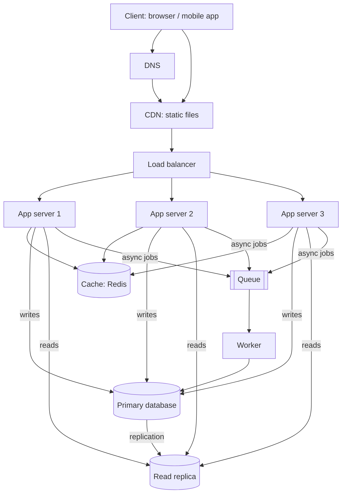

# QuickNotes Architecture

## Requirements

**Functional**

- Register and log in.
- Create, read, update and delete notes.
- Tag notes and filter by tag.
- List a user's notes, newest first.

**Non-functional**

- **Availability:** 99.9% uptime (no single point of failure).
- **Latency:** list and read requests under 200 ms at the 95th percentile.
- **Scalability:** supports 1 million users and can grow by adding servers.
- **Durability:** no note is lost (backups and replication).
- **Security:** HTTPS everywhere, hashed passwords, users see only their own notes.
- **Consistency:** a user sees their own new note immediately; other views may lag by seconds.

## Load estimate (1 million users)

Assumptions: 20% are active daily (200,000 DAU), each reads notes 20 times and writes 2 times per day, one note is about 1 KB, peak traffic is 3x the average.

| Metric             | Calculation        | Result                                            |
| ------------------ | ------------------ | ------------------------------------------------- |
| Reads per day      | 200,000 x 20       | 4,000,000                                         |
| Reads per second   | 4,000,000 / 86,400 | about 46/s average, about 140/s peak              |
| Writes per day     | 200,000 x 2        | 400,000                                           |
| Writes per second  | 400,000 / 86,400   | about 4.6/s average, about 14/s peak              |
| New notes per year | 400,000 x 365      | about 146 million                                 |
| Storage per year   | 146 million x 1 KB | about 146 GB (about 300 GB with indexes and tags) |

The workload is read-heavy (about 10 reads per write), so a cache and read replica pay off. Traffic is modest; the design is about reliability and headroom, not extreme scale.

## Architecture diagram



Plain-text version:

```
Client -> DNS -> CDN (static files)
Client -> Load balancer -> App server 1 / 2 / 3
App servers -> Cache (Redis)
App servers -> Primary DB (writes) --replication--> Read replica (reads)
App servers -> Queue -> Worker -> Primary DB / email / search index
```

## Components

- **Client:** the web or mobile app where users read and write notes.
- **DNS:** turns `quicknotes.example` into the IP of the load balancer or CDN so users can find us (and lets us re-route if a region fails).
- **CDN:** serves HTML, CSS and JavaScript from servers near the user, which cuts latency and removes static traffic from our servers.
- **Load balancer:** spreads requests across app servers and stops sending traffic to unhealthy ones, so no single server is overloaded or fatal.
- **App servers (3, stateless):** run the API logic; because they hold no session state, we can add or remove servers freely and survive crashes.
- **Cache (Redis):** keeps hot results (such as a user's first page of notes) in memory so repeated reads skip the database.
- **Primary database:** the single source of truth that accepts all writes.
- **Read replica:** a copy of the primary that serves read queries, reducing load on the primary and acting as a standby if the primary fails.
- **Queue:** buffers slow background jobs so the API can answer quickly and absorb traffic spikes.
- **Worker:** takes jobs from the queue (welcome emails, search indexing, cleanup, exports) and runs them outside the request path.

## Request flows

**GET /notes**

1. The client sends `GET /notes?limit=10` with its token.
2. DNS resolves the host; the request reaches the load balancer over HTTPS.
3. The load balancer picks a healthy app server.
4. The app server validates the token and gets the user id.
5. It checks the cache for key `notes:user:17:page1`.
6. **Cache hit:** return the cached JSON (200 OK).
7. **Cache miss:** query the **read replica** (`WHERE user_id = 17 ORDER BY created_at DESC LIMIT 10`).
8. Store the result in the cache with a short TTL (for example 60 seconds).
9. Return `200 OK` with the JSON to the client.

**POST /notes**

1. The client sends `POST /notes` with the JSON body and token.
2. The load balancer forwards it to a healthy app server.
3. The app server validates the token and the input (title required, at most 100 characters); on failure it returns 400.
4. It inserts the note (and tag links) into the **primary database** in one transaction.
5. It deletes the cache key for that user's list so the next read is fresh.
6. It puts a job on the **queue** (for example "index note for search").
7. It returns `201 Created` with the new note and a `Location` header.
8. A **worker** takes the job from the queue and completes it in the background; failed jobs are retried.

## Trade-offs

1. **Cache vs. freshness:** a cache makes reads fast, but data can be stale. We invalidate on write and use a short TTL; the cost is extra complexity and a small chance of out-of-date lists for other devices.
2. **Read replica vs. consistency:** replicas lag the primary by milliseconds to seconds, so a note written a moment ago might not show on a replica. We accept eventual consistency for lists and read from the primary right after a user's own write.
3. **Queue vs. simplicity:** asynchronous work keeps the API fast but adds another system to run and means jobs finish a little later.
4. **SQL vs. NoSQL:** SQL gives integrity and joins but scales writes vertically; at this size that is enough.

## Avoiding single points of failure

- **DNS and CDN:** use a managed provider with many edge locations.
- **Load balancer:** run a pair (active/active or managed multi-zone service).
- **App servers:** at least three, stateless, across availability zones.
- **Cache:** Redis with a replica and automatic failover; if the cache dies the app falls back to the database (slower, still working).
- **Database:** primary plus a read replica that can be promoted automatically; daily backups and point-in-time recovery.
- **Queue and workers:** a managed, replicated queue and multiple workers; unfinished jobs are retried.
