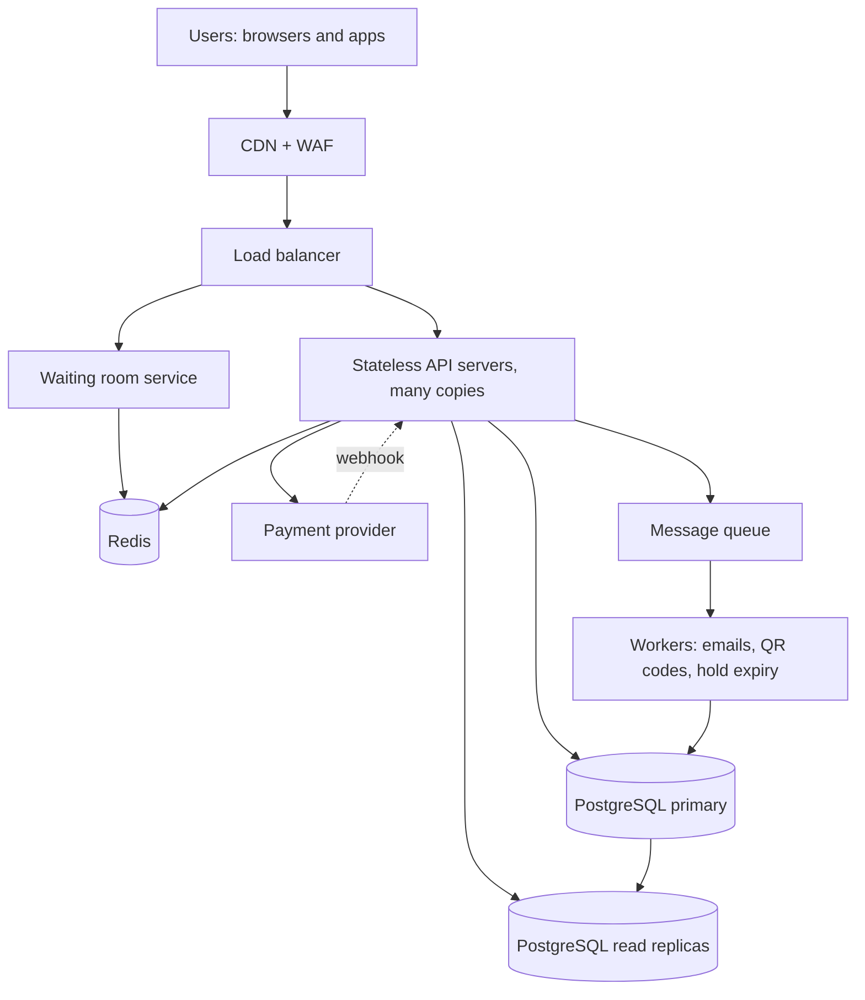

# TicketHub: Design Document

TicketHub is a website that sells tickets for concerts and events. This document follows the six-part framework: requirements, estimates, API, data model, architecture, and trade-offs. It also explains how the design prevents two people from buying the same seat.

---

## 1. Requirements

### Functional requirements

1. Users can register, log in and log out.
2. Users can browse and search events by name, date, city and category.
3. Users can open an event and see a seat map showing which seats are available.
4. Users can select seats and **hold** them for a limited time (5 minutes) while they pay.
5. Users can pay for held seats and receive confirmed tickets.
6. Users can view their tickets (with a QR code) and past orders.
7. Users can release a hold or let it expire; expired seats return to sale.
8. Admins can create events and set seat layouts and prices (out of scope for the detailed design).

### Non-functional requirements

| Quality          | Requirement                                                                                                                                                                                    |
| ---------------- | ---------------------------------------------------------------------------------------------------------------------------------------------------------------------------------------------- |
| **Speed**        | Browsing pages respond in under 300 ms (p95). Seat map loads in under 500 ms (p95). Placing a hold responds in under 1 s (p95), even during a big sale.                                        |
| **Correctness**  | A seat is never sold to two people. A user is never charged for seats they do not receive. A paid order always results in tickets. This outranks speed and availability for the purchase path. |
| **Fairness**     | During a big sale, people are served roughly in the order they arrived. One person cannot hoard seats: maximum 4 tickets per order and per event per account. Bots are rate-limited.           |
| **Availability** | 99.9% for browsing; 99.95% during announced sale windows. If something must fail, it fails by refusing to sell, never by double-selling.                                                       |
| **Scalability**  | Handles the 500x traffic spike of a popular sale without manual intervention.                                                                                                                  |
| **Durability**   | Orders and payments are never lost (database replication and backups).                                                                                                                         |
| **Security**     | Passwords hashed, HTTPS everywhere, card data handled only by the payment provider.                                                                                                            |

---

## 2. Estimates

### Normal day

- 50,000 visitors × 10 pages = **500,000 page views/day**
- 500,000 ÷ 86,400 s ≈ **6 requests/s on average**
- Traffic is not flat. Assuming a daily peak of about 10× the average: **~60 requests/s**
- **5,000 tickets/day** ≈ 0.06 tickets/s on average (about 1/s at the daily peak). This is tiny.
- Storage: 5,000 tickets/day ≈ 1.8 million tickets/year × ~200 bytes ≈ **under 1 GB/year**. A single database holds this easily.
- Users: 2 million rows × ~500 bytes ≈ 1 GB.

### Big sale (one popular concert)

- 200,000 users trying to buy 20,000 seats in the first 10 minutes (600 s).
- Arrivals: 200,000 ÷ 600 ≈ **333 users/s on average**, but most arrive in the first seconds after the sale opens, so the true peak may be about **3,000 users/s**.
- Each user makes roughly 10 requests in the first minutes (event page, seat map, a few refreshes, hold attempts, retries): 333 × 10 ≈ **3,300 requests/s sustained**, with bursts of 10,000+/s.
- Seat hold attempts: assume 3 attempts per user (many seats are taken before they click) → 600,000 ÷ 600 ≈ **1,000 hold attempts/s**, against only 20,000 seats. That is **10 people competing for every seat**.
- Successful purchases: at most 20,000 tickets in 10 minutes ≈ **33 tickets/s**.

### Comparison

| Metric              | Normal day         | Big sale           | Ratio        |
| ------------------- | ------------------ | ------------------ | ------------ |
| Requests/s          | ~6 avg (~60 peak)  | ~3,300 sustained   | ~50x to 500x |
| Ticket purchases/s  | 0.06 avg (~1 peak) | ~33                | ~30x to 500x |
| Contention per seat | almost none        | 10 people per seat | n/a          |

**Conclusion:** normal traffic could run on one small server. The big sale is the design problem. Its real danger is not volume of reads (those can be cached) but **hundreds of people fighting over the same few rows at the same instant**, which is a correctness and fairness problem.

---

## 3. API

All endpoints are JSON over HTTPS. Authenticated endpoints use a bearer token.

| #   | Method and path                        | Purpose                                                                                                        | Notes                                                                            |
| --- | -------------------------------------- | -------------------------------------------------------------------------------------------------------------- | -------------------------------------------------------------------------------- |
| 1   | `POST /auth/login`                     | Log in, returns token                                                                                          | Rate-limited                                                                     |
| 2   | `GET /events?query=&city=&date=&page=` | Browse and search events                                                                                       | Public, cached at CDN                                                            |
| 3   | `GET /events/{event_id}`               | Event details and sale status                                                                                  | Public, cached                                                                   |
| 4   | `GET /events/{event_id}/seats`         | Seat map with each seat's status (available / held / sold)                                                     | Cached 1-2 s; may be slightly stale                                              |
| 5   | `POST /events/{event_id}/queue`        | Join the waiting room for a big sale; returns a queue position and, when admitted, a time-limited access token | Only for flagged high-demand events                                              |
| 6   | `POST /events/{event_id}/holds`        | Hold seats: body `{ "seat_ids": [101, 102] }`; returns `hold_id` and `expires_at`                              | Requires auth. Returns `409 Conflict` if any seat is unavailable. All-or-nothing |
| 7   | `DELETE /holds/{hold_id}`              | Release a hold early                                                                                           |                                                                                  |
| 8   | `POST /orders`                         | Create an order from a valid hold: `{ "hold_id": "..." }`                                                      | Header `Idempotency-Key` required                                                |
| 9   | `POST /orders/{order_id}/payment`      | Pay for the order; returns payment status                                                                      | Idempotent. Calls the payment provider                                           |
| 10  | `GET /me/tickets`                      | List the user's tickets (event, seat, QR code)                                                                 | Auth required                                                                    |
| 11  | `GET /me/orders/{order_id}`            | View an order and its status                                                                                   | Auth required                                                                    |

Example hold request and responses:

```
POST /events/42/holds
{ "seat_ids": [101, 102] }

201 Created
{ "hold_id": "h_8f3a", "seat_ids": [101, 102], "expires_at": "2026-10-25T19:05:00Z" }

409 Conflict
{ "error": "SEAT_UNAVAILABLE", "unavailable_seat_ids": [102] }
```

---

## 4. Data model

Relational database (PostgreSQL), because seat ownership needs transactions and constraints.

### Tables

**users**
| column | type | notes |
|---|---|---|
| id | bigint PK | |
| email | text | UNIQUE, NOT NULL |
| password_hash | text | NOT NULL |
| created_at | timestamptz | |

**events**
| column | type | notes |
|---|---|---|
| id | bigint PK | |
| name | text | NOT NULL |
| venue | text | |
| city | text | indexed |
| starts_at | timestamptz | indexed |
| sale_opens_at | timestamptz | |
| total_seats | int | |
| high_demand | boolean | enables the waiting room |

**seats** (one row per seat per event)
| column | type | notes |
|---|---|---|
| id | bigint PK | |
| event_id | bigint FK → events.id | |
| section, row_label, seat_number | text/int | UNIQUE (event_id, section, row_label, seat_number) |
| price_cents | int | CHECK (price_cents >= 0) |
| status | text | CHECK (status IN ('available','held','sold')) |
| held_by | bigint FK → users.id | NULL unless held |
| hold_expires_at | timestamptz | NULL unless held |
| | | CHECK ((status = 'held') = (held_by IS NOT NULL AND hold_expires_at IS NOT NULL)) |

**orders**
| column | type | notes |
|---|---|---|
| id | bigint PK | |
| user_id | bigint FK → users.id | |
| event_id | bigint FK → events.id | |
| status | text | CHECK IN ('pending','paid','failed','cancelled') |
| total_cents | int | |
| idempotency_key | text | UNIQUE per user |
| created_at | timestamptz | |

**tickets** (one row per seat sold)
| column | type | notes |
|---|---|---|
| id | bigint PK | |
| order_id | bigint FK → orders.id | |
| seat_id | bigint FK → seats.id | **UNIQUE** |
| qr_code | text | UNIQUE |

**payments**
| column | type | notes |
|---|---|---|
| id | bigint PK | |
| order_id | bigint FK → orders.id | |
| provider_ref | text | UNIQUE, from the payment provider |
| amount_cents | int | |
| status | text | |

### Relationships

- A **user** has many **orders** (1 to many).
- An **event** has many **seats** (1 to many) and many **orders** (1 to many).
- An **order** has many **tickets** (1 to many) and one or more **payments** (1 to many, to allow retries).
- A **seat** has at most one **ticket** (1 to 0..1), enforced by `UNIQUE (seat_id)` on `tickets`.
- A **user** may currently hold many **seats** through `seats.held_by`.

---

## 5. How double-booking is prevented

Two people clicking the same seat at the same millisecond must never both succeed. The design uses **four layers**, and the database is the final authority.

### Layer 1: An atomic, conditional hold (transaction + row locks)

Holding seats is a single transaction. Seat ids are sorted first to avoid deadlocks between two users who select overlapping seats in different orders.

```sql
BEGIN;
UPDATE seats
SET status = 'held', held_by = :user_id,
    hold_expires_at = now() + interval '5 minutes'
WHERE id = ANY(:seat_ids)
  AND event_id = :event_id
  AND ( status = 'available'
        OR (status = 'held' AND hold_expires_at < now()) );
-- If rows_updated != number of seats requested: ROLLBACK and return 409.
COMMIT;
```

`UPDATE` takes a lock on each row it changes. If two transactions target the same seat, the second one waits until the first commits, then re-checks the `WHERE` condition. The seat is now `held`, so the second update matches **zero rows** and fails. Only one transaction can ever win, and the check and the write happen together, so there is no gap between "is it free?" and "take it" for another user to slip into. It is all-or-nothing: if any one of the requested seats is gone, the whole hold is rolled back so the user is never left with a partial set.

### Layer 2: Re-validation at payment time

When creating the order and charging, a second transaction confirms the user still owns a non-expired hold on every seat (`status='held' AND held_by=:user AND hold_expires_at > now()`) using `SELECT ... FOR UPDATE`. If the hold expired and someone else took the seat, the order fails _before_ any money is charged. Only after the payment provider confirms success does a final transaction insert the `tickets` rows and set the seats to `sold`.

### Layer 3: Database constraints as a safety net

Even if there were a bug in the application code, `UNIQUE (seat_id)` on `tickets` makes it **physically impossible** to insert two tickets for the same seat: the second insert is rejected by the database. The `CHECK` constraints also stop a seat from being in an inconsistent state (for example `held` with no owner).

### Layer 4: Idempotency and expiry

- `POST /orders` and `/payment` require an idempotency key (`UNIQUE` per user), so a double-click or network retry creates one order and one charge, never two.
- A background job runs every 30 seconds and releases expired holds (`status='available'`) so abandoned seats return to sale. The `OR hold_expires_at < now()` clause in Layer 1 means correctness never depends on that job being on time.

**Important:** Redis and the CDN cache are used only to _display_ seat maps. They are never trusted to decide who owns a seat. Only the PostgreSQL transaction decides.

---

## 6. Architecture



### Components

| Component                   | What it does                                                                                                                                                                                      | Why it is there                                                                                                                           |
| --------------------------- | ------------------------------------------------------------------------------------------------------------------------------------------------------------------------------------------------- | ----------------------------------------------------------------------------------------------------------------------------------------- |
| **CDN + WAF**               | Serves event pages, images and static files from edge locations; blocks abusive traffic and obvious bots.                                                                                         | Most of the 3,300 requests/s are reads of identical content. The CDN absorbs them so they never reach our servers.                        |
| **Load balancer**           | Spreads requests across API servers and drops unhealthy ones.                                                                                                                                     | No single server is a bottleneck or a single point of failure.                                                                            |
| **Waiting room service**    | For events flagged `high_demand`, puts users in a queue (ordered by arrival time, with a random shuffle for the first second to blunt bots) and admits them in small batches with a signed token. | Protects the database from 200,000 simultaneous buyers and gives fairness. Only a controlled number (e.g. 500/s) reach the hold endpoint. |
| **API servers**             | Stateless application servers that implement the endpoints above.                                                                                                                                 | Stateless means we can add more copies quickly when a sale is announced (auto-scaling).                                                   |
| **Redis**                   | Caches event details and seat maps (1-2 s TTL), stores waiting-room queues and rate-limit counters.                                                                                               | Takes read load off the database. Not the source of truth for seats.                                                                      |
| **PostgreSQL primary**      | Stores users, events, seats, orders, tickets, payments. All holds and purchases write here.                                                                                                       | Gives us ACID transactions, row locks and constraints, the foundation of no double-booking.                                               |
| **Read replicas**           | Serve browsing, search and "my tickets" reads.                                                                                                                                                    | Keeps read traffic off the primary so it only handles the ~1,000 writes/s of holds and orders.                                            |
| **Payment provider**        | Handles card data and charging; sends a webhook when payment completes.                                                                                                                           | We never touch card numbers. The webhook confirms payments even if the user closes their browser.                                         |
| **Message queue + workers** | Handle slow jobs off the request path: confirmation emails, QR code generation, expiring holds.                                                                                                   | Keeps the buy request fast and lets work retry safely if it fails.                                                                        |

### How it survives the big sale

1. **The CDN and Redis absorb reads.** Event pages and seat maps are cached, so most of the ~3,300 requests/s never reach the database.
2. **The waiting room flattens the spike.** Instead of 3,000 users/s hitting the hold endpoint at second one, the database sees a steady, controlled stream.
3. **Writes are small and fast.** A hold is one short transaction on a handful of rows, so 1,000 attempts/s is well within what one tuned PostgreSQL primary can do. Contention is handled by row locks, and losers get a quick `409` rather than waiting.
4. **Slow work leaves the hot path.** Payment confirmation, emails and QR codes go through the queue.
5. **Pre-scaling.** Sales are scheduled, so we add API servers, warm the cache and load-test before `sale_opens_at`.
6. **Failure mode is safe.** If the database is overloaded, requests fail or wait in the queue. Seats are never double-sold.

---

## 7. Trade-offs

### Trade-off 1: Strong consistency for seats vs. a slightly stale seat map

The seat map is cached for 1-2 seconds, so a user may see a seat as available when it was just taken, and then get a `409` when they click it. We accept this because making every seat-map view hit the primary database would multiply load by hundreds during a sale. Correctness is not at risk, since the hold itself always goes to the database. The cost is a worse experience: some users hit a "seat just taken" message. We soften it by returning the up-to-date unavailable seats in the `409` response so the UI can refresh immediately.

### Trade-off 2: A waiting room improves fairness and stability, but adds friction

The waiting room protects the system and gives an orderly first-come-first-served experience, but users must wait, and some will give up or complain, and it is extra infrastructure to build and operate. The alternative, letting everyone in at once, would be simpler but would likely overload the database and favour people with the fastest connections and bots. We chose fairness and safety over simplicity, and only enable it for `high_demand` events so ordinary sales stay frictionless.

### Trade-off 3: Hold duration (5 minutes)

A short hold returns abandoned seats to the pool quickly, which is good for other buyers, but is stressful for users entering card details and may cause failed purchases. A long hold is friendlier but lets people (or bots) lock up seats without paying. We chose 5 minutes, with a visible countdown, and a limit of 4 seats per order to reduce hoarding.

### Trade-off 4: One PostgreSQL primary vs. sharding

A single primary keeps transactions simple and strongly consistent. At 33 tickets/s and 1,000 holds/s it is sufficient, and sharding would add complexity for no current benefit. The downside is that the primary is a limit and a single point of failure; we mitigate it with a hot standby for failover. If we later sold tickets for many mega-events at once, we could shard by `event_id`, which fits naturally because a seat never needs to be compared with seats from another event.

### Trade-off 5: Pay after hold, rather than charge-then-assign

Holding first, then charging, means a user never pays for a seat they cannot have. The cost is that seats are briefly locked and may go unsold if payment fails. Charging first and assigning seats later would avoid locking but risks charging people and then refunding them, which is worse for trust.
