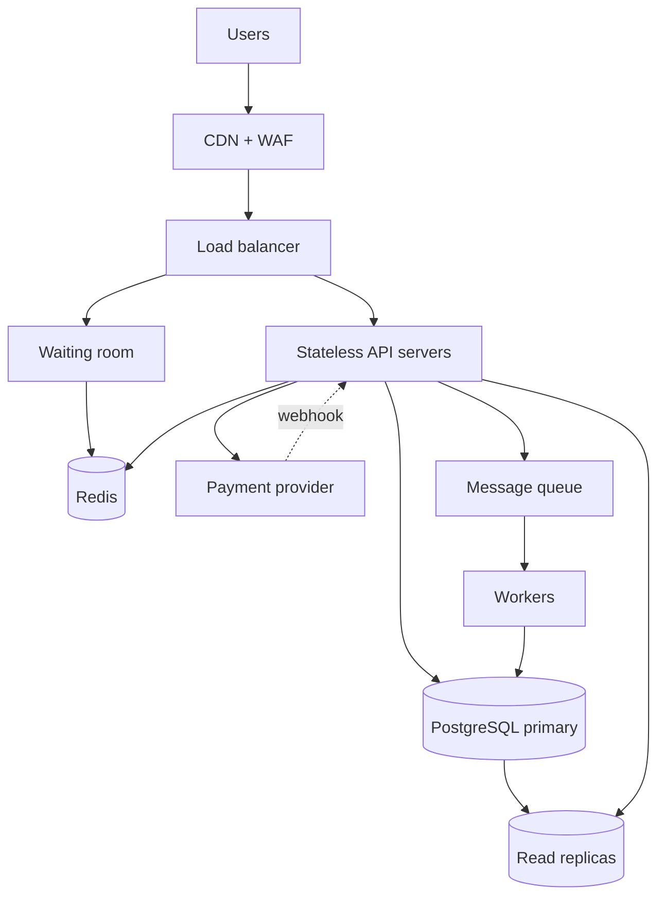

# TicketHub: Design Document

**Summary.** TicketHub sells tickets for concerts and events. Normal traffic is small (~6 requests/s). A big sale is ~3,300 requests/s with 10 people fighting for each seat, so the design focuses on **correctness under contention**: a CDN and cache absorb reads, a waiting room meters buyers, and a PostgreSQL transaction plus a UNIQUE constraint guarantees that no seat is sold twice.

## 1. Requirements

**Functional**

1. Register, log in and log out.
2. Browse and search events by name, date, city, category.
3. View an event's seat map with each seat's status.
4. Hold selected seats for 5 minutes while paying.
5. Pay for held seats and receive tickets.
6. View my tickets and orders.
7. Release a hold, or let it expire so seats return to sale.

**Non-functional**

- **Speed:** browsing p95 < 300 ms; seat map p95 < 500 ms; placing a hold p95 < 1 s, even during a big sale.
- **Correctness (highest priority on checkout):** a seat is never sold twice; nobody is charged for seats they do not receive; a paid order always yields tickets.
- **Fairness:** first-come-first-served in a big sale; max 4 seats per order and per event per account; bots rate-limited.
- **Availability:** 99.9% for browsing, 99.95% in sale windows. When something fails, it must refuse to sell rather than double-sell.
- **Durability and security:** orders and payments never lost (replication, backups); passwords hashed; HTTPS; card data handled only by the payment provider.

## 2. Estimates

**Normal day**

- 50,000 visitors × 10 pages = 500,000 page views/day ≈ **6 requests/s** average, ~60/s at a 10× daily peak.
- 5,000 tickets/day ≈ 0.06/s average (~1/s peak).
- Storage: ~1.8 million tickets/year × ~200 bytes ≈ under 1 GB/year. One database is plenty.

**Big sale** (200,000 people, 20,000 seats, 10 minutes = 600 s)

- 200,000 ÷ 600 ≈ 333 users/s on average (up to ~3,000/s in the first seconds).
- ~10 requests per user → **~3,300 requests/s sustained**.
- ~3 hold attempts per user → 600,000 ÷ 600 ≈ **1,000 hold attempts/s** for 20,000 seats, i.e. **10 people per seat**.
- Successful sales: at most 20,000 tickets ≈ **33/s**.

**Comparison:** requests rise from ~6/s to ~3,300/s (about 500× the average), and purchases from 0.06/s to 33/s. Reads can be cached. The real danger is **many people writing to the same seat rows at once**.

## 3. API

JSON over HTTPS; bearer token for authenticated routes.

1. `POST /auth/login` - log in, returns token.
2. `GET /events?query=&city=&date=&page=` - browse and search (public, CDN-cached).
3. `GET /events/{event_id}` - event details and sale status (public, cached).
4. `GET /events/{event_id}/seats` - seat map with status available/held/sold (cached 1-2 s, may be slightly stale).
5. `POST /events/{event_id}/queue` - join the waiting room for a high-demand sale; returns position, then an access token.
6. `POST /events/{event_id}/holds` - body `{"seat_ids":[101,102]}`; returns `hold_id` and `expires_at`, or `409 SEAT_UNAVAILABLE`. All-or-nothing.
7. `DELETE /holds/{hold_id}` - release a hold early.
8. `POST /orders` - create an order from a valid `hold_id`; requires an `Idempotency-Key` header.
9. `POST /orders/{order_id}/payment` - pay via the payment provider; idempotent.
10. `GET /me/tickets` - list my tickets (event, seat, QR code).
11. `GET /me/orders/{order_id}` - view one order and its status.

## 4. Data model (PostgreSQL)

- **users**(id PK, email UNIQUE, password_hash, created_at)
- **events**(id PK, name, venue, city, starts_at, sale_opens_at, high_demand)
- **seats**(id PK, event_id FK→events, section, row_label, seat_number, price_cents, status, held_by FK→users, hold_expires_at). UNIQUE(event_id, section, row_label, seat_number). CHECK status IN ('available','held','sold'). CHECK that held_by and hold_expires_at are set only when status='held'.
- **orders**(id PK, user_id FK→users, event_id FK→events, status, total_cents, idempotency_key UNIQUE per user, created_at)
- **tickets**(id PK, order_id FK→orders, seat_id FK→seats **UNIQUE**, qr_code UNIQUE)
- **payments**(id PK, order_id FK→orders, provider_ref UNIQUE, amount_cents, status)

**Relationships:** a user has many orders; an event has many seats and many orders; an order has many tickets and one or more payments (retries); a seat has at most one ticket (enforced by UNIQUE seat_id).

## 5. Preventing two people from buying the same seat

The database is the final authority, using four layers.

1. **Atomic conditional hold (transaction + row lock).** Seat ids are sorted first to avoid deadlocks.

```sql
BEGIN;
UPDATE seats SET status='held', held_by=:user,
       hold_expires_at = now() + interval '5 minutes'
WHERE id = ANY(:seat_ids) AND event_id = :event
  AND (status='available' OR (status='held' AND hold_expires_at < now()));
-- rows updated != seats requested  ->  ROLLBACK, return 409
COMMIT;
```

`UPDATE` locks each row. If two users target one seat, the second waits, re-checks the WHERE clause after the first commits, finds the seat already held, updates 0 rows and gets a 409. Check and write are one step, so there is no gap to slip into. It is all-or-nothing, so nobody ends up with a partial set. 2. **Re-validate at payment.** Before charging, `SELECT ... FOR UPDATE` confirms the user still holds every seat and the hold has not expired. Otherwise the order fails before any money is taken. Only after the provider confirms payment are `tickets` inserted and seats set to `sold`. 3. **Constraints as a safety net.** `UNIQUE(seat_id)` on `tickets` makes a second ticket for the same seat impossible, even if application code has a bug. CHECK constraints stop inconsistent seat states. 4. **Idempotency and expiry.** Idempotency keys make a double-click or retry create one order and one charge. A job every 30 s frees expired holds, and the `hold_expires_at < now()` clause in step 1 means correctness never depends on that job running on time.

Redis and the CDN only _display_ seat maps. They never decide who owns a seat.

## 6. Architecture



- **CDN + WAF:** serves cached pages and images from the edge and blocks abusive traffic, so most of the 3,300 requests/s never reach our servers.
- **Load balancer:** spreads requests and removes unhealthy servers; no single point of failure.
- **Waiting room:** for `high_demand` events, queues users by arrival time and admits them in small batches (e.g. 500/s) with a signed token. It protects the database and gives fairness.
- **API servers:** stateless, so more copies can be added before a sale.
- **Redis:** caches event details and seat maps (1-2 s), holds queues and rate-limit counters. Not the source of truth.
- **PostgreSQL primary:** all writes (holds, orders, tickets, payments) with ACID transactions, locks and constraints.
- **Read replicas:** serve browsing, search and "my tickets", keeping reads off the primary.
- **Payment provider:** takes card data and charges; the webhook confirms payment even if the user closes the browser.
- **Queue + workers:** emails, QR codes and hold expiry run off the request path and can retry safely.

**Surviving the big sale:** (1) CDN and Redis absorb reads; (2) the waiting room turns a spike into a steady stream; (3) a hold is one short transaction, so ~1,000/s is fine for one primary and losers get a fast 409; (4) slow work goes through the queue; (5) servers are pre-scaled and the cache warmed before `sale_opens_at`; (6) if overloaded, the system refuses or queues requests but never double-sells.

## 7. Trade-offs

1. **Strong seat consistency vs. a slightly stale seat map.** The seat map is cached 1-2 s, so a user may click a seat that was just taken and get a 409. We accept this because reading every map from the primary would multiply load hundreds of times. Correctness is unaffected because the hold always goes to the database; the 409 returns the latest unavailable seats so the UI refreshes at once.
2. **Waiting room: fairness and stability vs. friction.** It protects the database and gives an orderly queue, but users must wait and it is extra infrastructure. Letting everyone in at once is simpler but risks overload and favours bots and fast connections. We enable it only for high-demand events.
3. **Hold length (5 minutes).** Short holds free abandoned seats quickly but pressure users paying; long holds let people lock seats without buying. We chose 5 minutes with a visible countdown and a 4-seat limit.
4. **One primary vs. sharding.** One primary keeps transactions simple and handles 1,000 writes/s. The cost is a single point of failure, mitigated by a hot standby. If load grows, we can shard by `event_id`, since a seat never interacts with another event's seats.
5. **Hold first, then charge.** Nobody pays for a seat they cannot have, at the cost of briefly locked seats if payment fails. Charging first would risk refunds, which hurts trust more.
